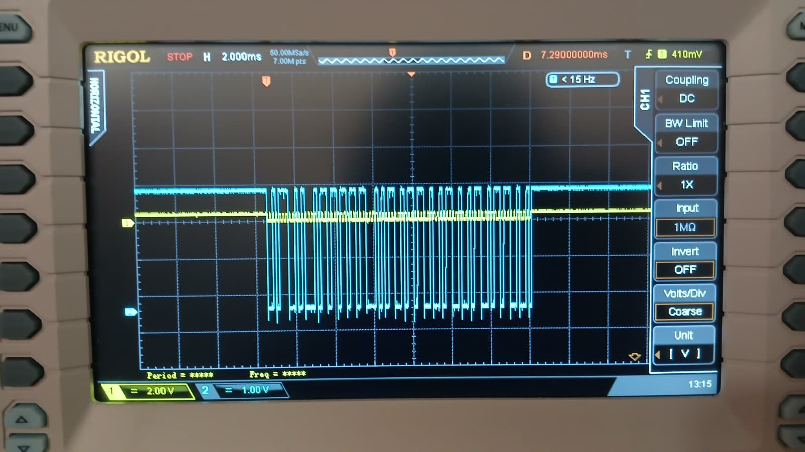
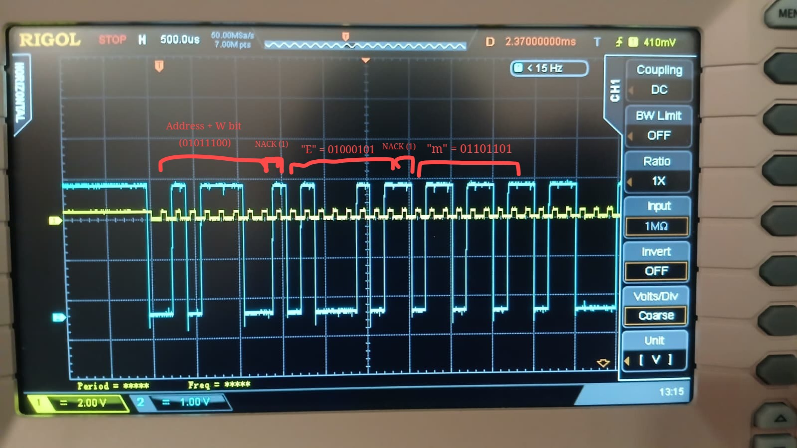

# I2C Bit-Banging Implementation

This I2C Write implementation uses software-controlled GPIO pins on the NUCLEOF446RE to send out a message, without using the STM32 I2C peripheral or its HAL library. The implementation is verified using an oscilloscope.

## Implementation
PC2 is set up as the SDA line and PC3 is set up as the SCL line. Both were initialized as GPIO Open Drain Output pins in Pull Up mode because I2C works on open drain to VCC, allowing them to be pulled LOW and released HIGH. 

Since this implementation is only for writing data, the R/W bit is set to Write (0), and a dummy address of 0x2E is used for the slave. The message sent is "Embedded Systems".

The timing is generated using software delays implemented with __NOP() instructions. While this results in the clock frequency depending on processor speed, compiler optimization, and instruction execution time, it is adequate for this lab and is chosen for simplicity.

Polling is used instead of interrupts because the transaction is short and executes sequentially.

The code is divided into separate functions for generating the START and STOP conditions, transmitting data and sending the address. 

- **I2C_START()** - starting at the idle state (HIGH) for both lines, this transitions the SDA line from HIGH to LOW while the SCL line remains HIGH, signalling a START condition
- **I2C_STOP()** - this transitions the SDA line from LOW to HIGH while the SCL line remains HIGH, signalling a STOP condition.
- **I2C_Write()** - writes the byte bit by bit by pulling SDA HIGH or LOW in each SCL cycle. Adds the 9th bit ACK/NACK.
- **I2C_Address()** - writes the 7-bit address + the R/W bit.

## Oscilloscope Testing
PC2 (SDA) was hooked up to probe 1 (yellow), PC3 (SCL) was hooked up to probe 2 (blue).

Figure 1: Full message "Embedded" sent over I2C

Figure 2: Zoomed in picture showing the bits clearly labeled.

## Video Link

## Conclusion
Overall this project helped deepen my understanding of I2C and gave valuable experience with oscilloscope testing. I did not face any significant challenges!